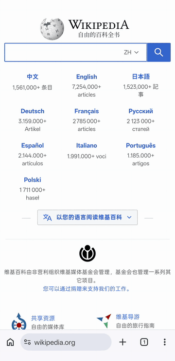
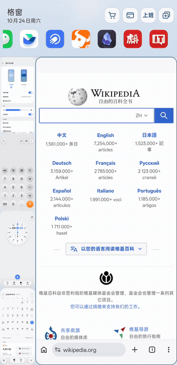
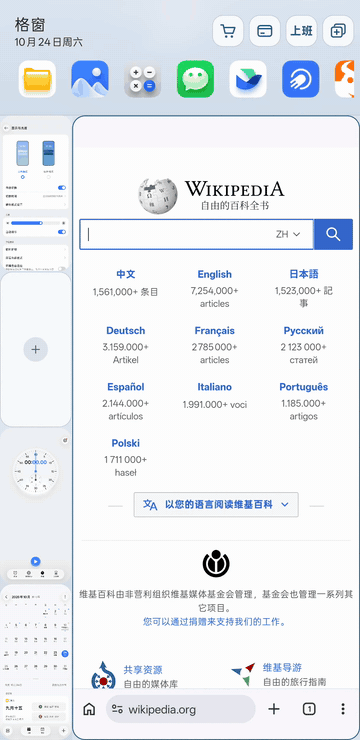
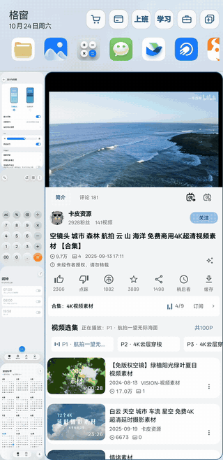
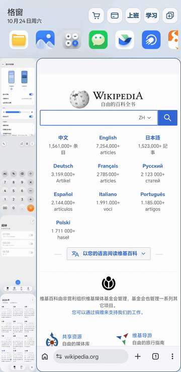
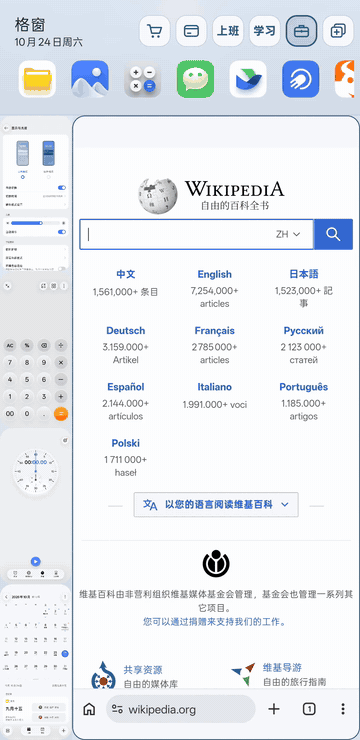
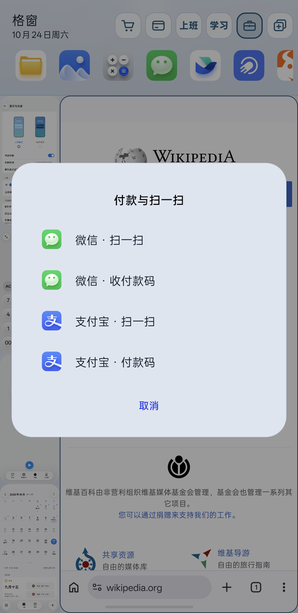
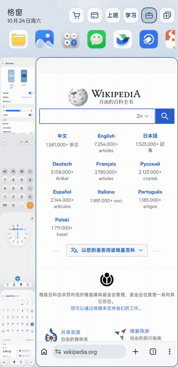
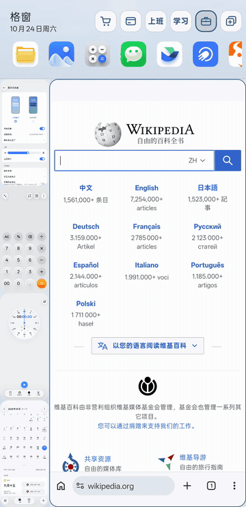

  

<h1 align="center">格窗 Panes</h1>

一扇窗，几件事。

  <a href="README.md">中文</a> / <a href="README_EN.md">English</a>

  
  
  
  

格窗是一个 LSPosed 模块，给 ColorOS 17 的原生桌面加一个侧边工作台：一个大窗做事，四个小窗候着，常用的都放在手边。不替换桌面，不改系统主题，退出后手机回到原样。

  

## 功能

### 一个大窗，四个小窗

大窗是你正在用的应用，侧栏四个小窗是四个真实运行中的应用，各自跑在独立的虚拟显示器上，不是截图。点一下小窗，它和大窗原地对调，画面等比缩放，不拉伸、不裁切；长按拖动可以换位置，或者把应用退到后台。

  

### 常用应用栏

顶部一排常用应用：设置里固定的排在最前面，其余按最近七天的使用时间补齐，最多十个。点图标在大窗打开；长按拖到某个小窗，就在那个小窗打开。空小窗上的「＋」也能加应用：原来的大窗应用先收进这个小窗，回到桌面挑一个新应用放进大窗。

  

### 横屏视频自动上去

大窗里的应用请求横屏（比如点了全屏播放），视频收进顶部的宽窗，默认 16:9 满宽，画面带黑边时按画面比例自动收窄，最多到 2.4:1。下面的大窗和另外三个小窗照常使用，宽窗里也能直接点暂停、拖进度；退出全屏，视频回到大窗。

  

### 工作场景

选好大窗和四个小窗的应用，点顶栏最右边的添加按钮，当前这一套就存成一个场景，可以选八个预设图标之一（工作、学习、游戏、影音、阅读、购物、出行、生活），也可以输入两个汉字或四个字母当按钮。点场景按钮一键换成那一套，当前布局正好是某个场景时它会高亮；长按可以换图标或删除。最多 6 个，满了加号自动隐藏。场景也能从设置页添加到桌面，点一下直接打开整套（ColorOS 首次需允许「创建桌面快捷方式」权限）。

  

### 比价

比价是默认场景之一。输入一次商品词，同时在几个外卖或购物应用里搜，每个应用一个窗口，结果并排对照：外卖查京东秒送、淘宝闪购、美团外卖，购物查拼多多、抖音商城、京东、淘宝。只帮你打开搜索结果，不抓价格、不下单、不付款。

  

### 付款和扫码

另一个默认场景：微信扫一扫、微信收付款码、支付宝扫一扫、支付宝付款码，四个入口放在一个系统弹窗里。只负责打开对应页面，不读取账户，也不会替你确认付款。

  

### 发到格窗

在任何应用里分享链接或文字，选「发到格窗」，再选在大窗还是哪个小窗打开：链接用默认浏览器打开，其他文字用默认搜索。

  

### 浅色、深色，跟随系统

工作台可以跟随系统深浅色，也可以固定浅色或深色；小窗放左边还是右边、控制区放顶部还是底部，都在设置里改，立即生效。

  

## 使用要求

- ColorOS 17（Android 17）。在 OPPO Find X9s Pro（PME110）上开发和验证；其他机型和 ROM 需要自行适配，未经测试不保证兼容。
- Root（KernelSU 等）、Zygisk 与 LSPosed（支持 libxposed 新 API）。
- 本模块会修改 SystemUI、桌面和 system_server 的行为，请确保设备有可用的恢复手段。

## 安装

1. 从 [Releases](https://github.com/yishisanren/NeXtep/releases) 下载 APK 并安装（包名 `io.github.yishisanren.panes`）。
2. 在 LSPosed 中启用「格窗 Panes」，勾选内置[作用域列表](app/src/main/resources/META-INF/xposed/scope.list)里适用于本机的全部项目：SystemUI、系统框架、桌面、应用分身服务、负一屏。
3. 如果以前装过 NeXtep（包名 `io.github.lujinxin.nextep`），先在 LSPosed 里停用并卸载它，两个模块不能同时钩住 SystemUI。
4. 重启手机。
5. 打开「格窗」，选常用应用，添加控制中心开关。

## 打开与关闭

- **底角手势**：单指从左下角向右上、或右下角向左上斜滑，打开；工作台里再斜滑一次，关闭。起点在距底边和侧边各 96 dp 的角落内，向内、向上各滑 24 dp 以上；直上滑（系统主页手势）和水平滑（系统返回手势）不会触发。
- **控制中心开关**：设置页「打开方式 → 控制中心入口」添加，下拉控制中心点「格窗」切换。
- **设置页**：「遇到问题 → 退出小窗模式」。
- **Shell 命令**（自动化工具用，需 Root）：见 [docs/WORKBENCH.md](docs/WORKBENCH.md#shell-命令)。

## 设置

点桌面上的「格窗」图标进入，单页七组：

| 分组 | 内容 |
| --- | --- |
| 常用应用 | 选择和排序常用栏的应用；切换时收起上一个应用 |
| 工作场景 | 查看、删除场景，添加到桌面，恢复被删的默认场景 |
| 布局 | 跟随系统／浅色／深色，小窗靠左／靠右，控制区顶部／底部 |
| 打开方式 | 控制中心开关、底角手势 |
| 隐私 | 最近任务里隐藏工作台应用，本次允许截图／录屏 |
| 遇到问题 | 导出诊断、退出小窗模式 |
| 关于 | 版本、检查更新、署名 |

## 隐私与限制

- 工作台默认禁止截图和录屏，可以在设置里「本次允许」，退出、锁屏或打开设置后恢复禁止。
- 打开「最近任务隐藏」后，工作台里的应用不出现在最近任务里，退出工作台即恢复。
- 应用自己的安全保护（付款码、DRM 视频、企业策略等）照常生效，格窗不会解除。
- 诊断导出只保存模块最近 128 条事件，不含搜索词、链接、账户和画面。
- 横屏视频的识别依赖应用和系统：静音、没有媒体会话的竖屏播放器可能认不出来。

## 构建

见 [docs/BUILDING.md](docs/BUILDING.md)。功能边界与真机验证情况见 [docs/WORKBENCH.md](docs/WORKBENCH.md)，进程结构见 [docs/ARCHITECTURE.md](docs/ARCHITECTURE.md)。

## 支持作者

如果格窗帮到了你，可以用微信扫码请作者喝杯咖啡。App 设置页的「关于」里也有这张码。

  

## 署名与许可证

格窗基于 [lujinxin 的 NeXtep](https://github.com/lujinxin/NeXtep) 修改而来，NeXtep 致敬锤子科技 Smartisan OS 的 OneStep。本仓库沿用 [Apache License 2.0](LICENSE)，第三方声明见 [THIRD_PARTY_NOTICES.md](THIRD_PARTY_NOTICES.md)。

Copyright 2026 lujinxin（NeXtep）；修改部分 Copyright 2026 yishisanren。
